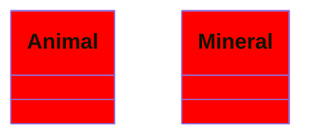
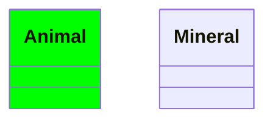

# mermaid: class diagram `classDef` styles leak onto classes that don't have that class

Cloud session report for the local session that opens the upstream PR.
Nothing was opened, edited or commented on in `mermaid-js/mermaid`.

## Branch to open the PR from

|             |                                                                                                      |
| ----------- | ---------------------------------------------------------------------------------------------------- |
| Fork branch | `b84330808/mermaid:claude/confident-cannon-x4zis0`                                                   |
| Commit      | `5ddf8eaa77ecb5024a14080239ab6ef251162a87` (one commit)                                              |
| Author      | `b84330808 <b84330808@gmail.com>`, trailer `Co-Authored-By: Claude Opus 5.5 <noreply@anthropic.com>` |
| Target      | `mermaid-js/mermaid:develop`                                                                         |
| Based on    | `upstream/develop` @ `1395ea06ec2f0329db1dcbc9bfb5690474dd9821` (Merge pull request #8385)           |

The PR labeler in `.github/pr-labeler.yml` gives `Type: Bug / Error` only to branches named `bug/...` or `fix/...`.
Your earlier PRs used `bug/<issue>_<desc>`. There is no issue for this bug, so if you want the label, push the same commit under a `bug/` name before opening the PR:

```bash
git fetch origin claude/confident-cannon-x4zis0
```

```bash
git push origin FETCH_HEAD:refs/heads/bug/class-classdef-exact-match
```

Files changed (3):

- `packages/mermaid/src/diagrams/class/classDb.ts`: one-line fix plus a comment
- `packages/mermaid/src/diagrams/class/classDiagram-styles.spec.js`: 3 new tests
- `.changeset/class-classdef-exact-match.md`: `'mermaid': patch`, message prefixed `fix:`

## The bug

`ClassDB.defineClass` copies a `classDef`'s styles onto every class it applies to, and the class box renders them as inline `style` (`classBox.ts`: `node.cssStyles = classNode.styles`).
To decide which classes it applies to, it checks:

```ts
if (value.cssClasses.includes(id)) {
```

`cssClasses` is a **string** of space-separated class names that always starts with `default` (e.g. `"default important"`), so this is a substring test, not a class-name test:

- Every class has `default`, so a `classDef` named `fault`, `def`, `ult`, `a`, `e`, `f`, `l`, `t`, `u` … styles **every class in the diagram**.
- `classDef port` styles a class marked `:::important` (or `:::support`, `:::report`, `:::export`); `classDef main` styles `:::domain`; `classDef click` styles every clickable class.

Minimal repros:



Both boxes are filled red, though neither has `fault`.



`Animal` is filled green, though it only has `important`.

The docs (`packages/mermaid/src/docs/syntax/classDiagram.md`, "Classes" and "Default class") say a class applies to the nodes it is attached to (`:::name` / `cssClass`), and that only a class named `default` applies to all nodes.
`requirementDb.ts` does the same check against an array (`value.classes.includes(id)`), which is an exact match. Only the class diagram uses the substring form.

The fix compares whole names:

```ts
// `cssClasses` is a space separated list, so compare whole class names, not substrings
if (value.cssClasses.split(' ').includes(id)) {
```

`classDef default` still reaches every class, because every class carries `default`. A new test pins that.

## Fail-before / pass-after

Command (from the repo root):

```bash
pnpm vitest run packages/mermaid/src/diagrams/class/classDiagram-styles.spec.js
```

**Fail-before.** Run with only `classDb.ts` reverted (`git stash push packages/mermaid/src/diagrams/class/classDb.ts`), keeping the new tests:

```
   × ... should not apply a classDef to a class whose css class only contains its name
   × ... should not apply a classDef whose name is part of "default" to every class

 FAIL  packages/mermaid/src/diagrams/class/classDiagram-styles.spec.js > class diagram,  > when parsing data from a classDiagram it > should not apply a classDef to a class whose css class only contains its name
AssertionError: expected [ 'fill:#0f0' ] to strictly equal []

- Expected
+ Received

- []
+ [
+   "fill:#0f0",
+ ]

 ❯ packages/mermaid/src/diagrams/class/classDiagram-styles.spec.js:122:51

 FAIL  packages/mermaid/src/diagrams/class/classDiagram-styles.spec.js > class diagram,  > when parsing data from a classDiagram it > should not apply a classDef whose name is part of "default" to every class
AssertionError: expected [ 'fill:#f00' ] to strictly equal []

- Expected
+ Received

- []
+ [
+   "fill:#f00",
+ ]

 ❯ packages/mermaid/src/diagrams/class/classDiagram-styles.spec.js:130:51

 Test Files  1 failed (1)
      Tests  2 failed | 11 passed (13)
```

The third new test (`should apply the default classDef to every class`) passes before and after, as intended. It guards the `default` behaviour.

**Pass-after** (fix applied):

```
 ✓ packages/mermaid/src/diagrams/class/classDiagram-styles.spec.js (13 tests) 89ms
 Test Files  1 passed (1)
      Tests  13 passed (13)
```

## Other checks run

| Check                                                                            | Result                                                                                                                                                                                   |
| -------------------------------------------------------------------------------- | ---------------------------------------------------------------------------------------------------------------------------------------------------------------------------------------- |
| `pnpm vitest run packages/mermaid` (whole mermaid package)                       | 339 files passed, 1 skipped; 6858 tests passed, 16 skipped, 2 todo; 0 failed                                                                                                             |
| `pnpm exec tsc -p packages/mermaid/tsconfig.json --noEmit` (includes spec files) | exit 0                                                                                                                                                                                   |
| `pnpm exec eslint --quiet` on the 3 changed files                                | clean                                                                                                                                                                                    |
| `pnpm exec prettier --check` on the 3 changed files                              | clean                                                                                                                                                                                    |
| `pnpm lint` (repo-wide: eslint, `lint:jison`, prettier)                          | exit 0. Needed `NODE_OPTIONS=--max_old_space_size=8192`: with Node's default heap, ESLint ran out of memory before checking anything. The repo's own pre-commit hook sets the same flag. |
| Real browser (Chromium via `pnpm dev` + Playwright, default theme)               | before: wrong fills; after: correct. Output below                                                                                                                                        |

Browser check: each repro was rendered with `mermaid.render` from the dev server, and the class box's inline `style` and computed `fill` were read back.

Before (fix reverted):

```
# classDef fault (substring of "default")
  Animal: fill=rgb(255, 0, 0)  style="fill:#f00"
  Mineral: fill=rgb(255, 0, 0)  style="fill:#f00"
# classDef port vs :::important
  Animal: fill=rgb(0, 255, 0)  style="fill:#0f0"
  Mineral: fill=rgb(240, 253, 250)  style=""
```

After (fix applied):

```
# classDef fault (substring of "default")
  Animal: fill=rgb(253, 244, 255)  style=""
  Mineral: fill=rgb(240, 253, 250)  style=""
# classDef port vs :::important
  Animal: fill=rgb(253, 244, 255)  style=""
  Mineral: fill=rgb(240, 253, 250)  style=""
```

(After the fix each box keeps its normal theme palette colour.)

The commit was made with the husky pre-commit hook bypassed. That hook only runs `eslint --fix` and `prettier --write` on staged files, and both were run by hand with no changes.
No Cypress/Playwright e2e test was added: the bug is in DB logic and the unit tests cover it directly.

## Duplicate search

All searches were run on github.com with no state filter, so they cover open, closed and merged issues and PRs.
I read every result page (all were one page). The GitHub API was not available for upstream in this session.

For this bug:

| Query                                              | Results                         | Relevant?                                                                                                                                                                                                                                                                                                                                             |
| -------------------------------------------------- | ------------------------------- | ----------------------------------------------------------------------------------------------------------------------------------------------------------------------------------------------------------------------------------------------------------------------------------------------------------------------------------------------------- |
| `classDiagram classDef substring`                  | 0                               | none                                                                                                                                                                                                                                                                                                                                                  |
| `classDef applied to all classes`                  | 19                              | none. Closest: #684 (closed 2020, `classDef default` not applying), #8107 (icon shapes ignore classDef), #8435 (state composites). All different bugs.                                                                                                                                                                                                |
| `classDiagram classDef style wrong class`          | 2 (#8147, #8115)                | none                                                                                                                                                                                                                                                                                                                                                  |
| `class diagram style applied every class classDef` | 15                              | none                                                                                                                                                                                                                                                                                                                                                  |
| PRs `is:pr classDb defineClass`                    | 1: #6212 (merged 2025 refactor) | no                                                                                                                                                                                                                                                                                                                                                    |
| PRs `is:pr classDiagram classDef`                  | 10                              | Only open one is **#6190** "chore: Add ability to get classDefs from classDb" (open, last commit Feb 2025). I read its diff: it edits nearby lines in `defineClass` (`style` → `styles` variable) but keeps `value.cssClasses.includes(id)` unchanged, so it does not fix this. If both merge there may be a small textual conflict in `defineClass`. |

Your own open PRs: **#8497** (dagre `mermaid-graphlib.js` cluster edges) and **#8498** (state diagram jison `as` id) touch different files and different diagrams. No overlap.

### Leads dropped because they were already taken

These came up during the hunt. Each was dropped because an open PR or issue already covers it:

| Lead                                                                                                           | Covered by                                                                                                                                |
| -------------------------------------------------------------------------------------------------------------- | ----------------------------------------------------------------------------------------------------------------------------------------- |
| Gantt `manualEndTime` checks `'YYYY-MM-DD'` instead of the diagram's `dateFormat`                              | open PR #8430                                                                                                                             |
| Gantt `taskDb` id index not reset in `clear()`                                                                 | open PR #8359                                                                                                                             |
| Class generics with commas / nesting (`Map~K, List~V~~`) mis-rendered                                          | open PRs #8362, #8275                                                                                                                     |
| `themeVariables` values containing `-` (e.g. `fontFamily: "Inter, sans-serif"`) blanked by `sanitizeDirective` | open issue #6256, open PR #6261 (found on page 2 of `sanitizeDirective` results)                                                          |
| A bare `%%` line breaks erDiagram and sankey                                                                   | `cleanupComments` is being rewritten by open PRs #8515 and #8447, which both deliberately keep bare `%%` lines; a fix there would collide |
| `markdownToLines` drops inline code / links / strikethrough / escapes when `htmlLabels: false`                 | inline code: issue #7013 + open PR #8456 (same lines); links: open PR #7470                                                               |
| Quadrant `1.0`, Gantt 4+ metadata items, Gantt end date with time                                              | open PRs #8514, #8201, #8055/#8062                                                                                                        |

Unclaimed but weaker leads, not pursued (possible follow-ups):

- `utils.ts` memoize cache keys (`wrapLabel`, `breakString`, `calculateTextDimensions`) concatenate fields with no separator. For example, `wrapLabel('Room 101', 50)` followed by `wrapLabel('Room 10', 150)` returns `"Room<br/>101"`, the first label's text. I reproduced it in a unit test. No issue or PR found. It needs two wrap widths with different digit counts, so it is rare in real diagrams.
- State diagram `classDef default …` is a parse error: the lexer returns `DEFAULT_CLASSDEF_ID` but the grammar rule expects `DEFAULT`. Not documented for state diagrams; not duplicate-checked.

---

## PR title

```
fix(class): apply a classDef only to classes that have that exact class
```

## PR body

Copy everything inside the four-backtick fence:

````markdown
## :bookmark_tabs: Summary

In class diagrams, a `classDef` is also applied to classes that were never given that class, as long as one of their class names _contains_ the `classDef` name.

`ClassDB.defineClass` decides which classes get the styles with `value.cssClasses.includes(id)`, but `cssClasses` is a space-separated string that always starts with `default` (for example `"default important"`). That makes it a substring test:

- every class has `default`, so `classDef fault …`, `classDef def …` or `classDef a …` styles **every** class in the diagram;
- `classDef port …` styles a class marked `:::important` (or `:::support`, `:::export`), `classDef main …` styles `:::domain`, and so on.


Both classes are drawn red, though neither has the `fault` class.


`Animal` is drawn green, though it only has `important`.

I could not find an existing issue for this.

## :straight_ruler: Design Decisions

`defineClass` now splits `cssClasses` and compares whole class names, which is what the docs describe (a class applies to the nodes it is attached to with `:::` or `cssClass`, and only `default` applies to all nodes) and matches how `requirementDb` checks its `classes` array. `classDef default` still reaches every class, since every class carries `default`.

Tests in `classDiagram-styles.spec.js`:

- a `classDef` whose name is part of another class name (`port` / `important`) is not applied;
- a `classDef` whose name is part of `default` (`fault`) is not applied to every class;
- `classDef default` is still applied to every class, together with a class's own `classDef`.

The first two fail without the fix (`expected [ 'fill:#0f0' ] to strictly equal []`, `expected [ 'fill:#f00' ] to strictly equal []`).

### :clipboard: Tasks

Make sure you

- [x] :book: have read the [contribution guidelines](https://mermaid.js.org/community/contributing.html)
- [x] :computer: have added necessary unit/e2e tests.
- [x] :notebook: have added documentation. Make sure [`MERMAID_RELEASE_VERSION`](https://mermaid.js.org/community/contributing.html#update-documentation) is used for all new features. (not needed: bug fix, behaviour now matches the existing docs)
- [x] :butterfly: If your PR makes a change that should be noted in one or more packages' changelogs, generate a changeset by running `pnpm changeset` and following the prompts. Changesets that add features should be `minor` and those that fix bugs should be `patch`. Please prefix changeset messages with `feat:`, `fix:`, or `chore:`.

I used Claude Code to write this change.
````
